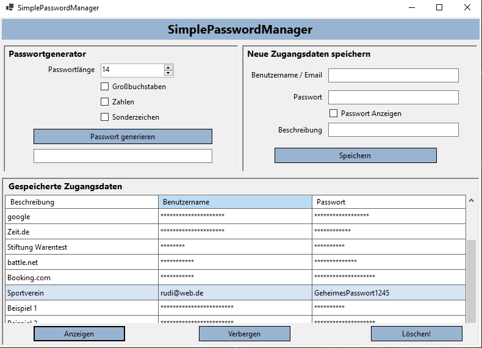
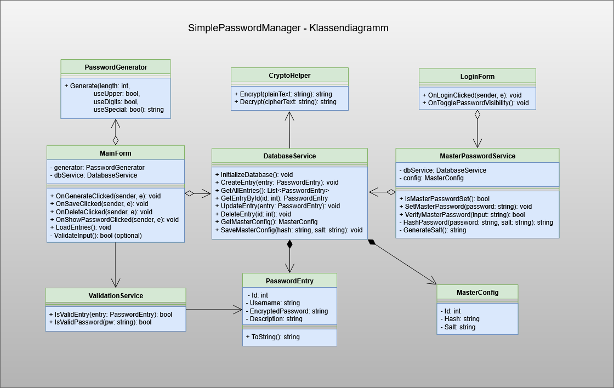
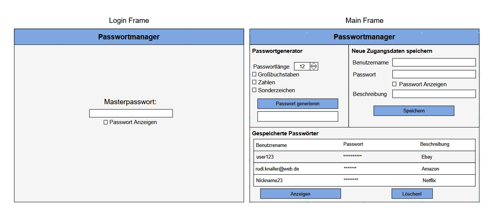

# 🔐 SimplePasswordManager

A small practice project for building a local password manager with **C#, .NET 8, Windows Forms, and SQLite**.

The main goal was to go through a complete software development process on a small scale — from planning and GUI mockups to UML class diagrams, implementation, testing, and documentation. Along the way, I practiced database access, encryption, and desktop UI development.

## ✨ Features

- 🔑 **Master password login** with salted SHA-256 hash verification
- 🖥️ **Windows Forms GUI** for managing passwords
- 🧠 **Password generator** with configurable length and character types
- ✅ **Input validation** and password checks
- 🔒 **AES-256 encryption** of stored passwords, using PBKDF2 for key derivation
- 💾 **Local SQLite storage** with Entity Framework Core
- 🧪 **Unit tests** with xUnit

## 🛠️ Technologies

C# · .NET 8 · Windows Forms · SQLite · Entity Framework Core · AES-256 · PBKDF2 · xUnit

## 📸 Screenshot

## 📚 Documentation

### UML Class Diagram

### GUI Mockup

### Project Documentation

[Project Documentation (PDF)](docs/Dokumentation/Dokumentation_SimplePasswordManager.pdf)
